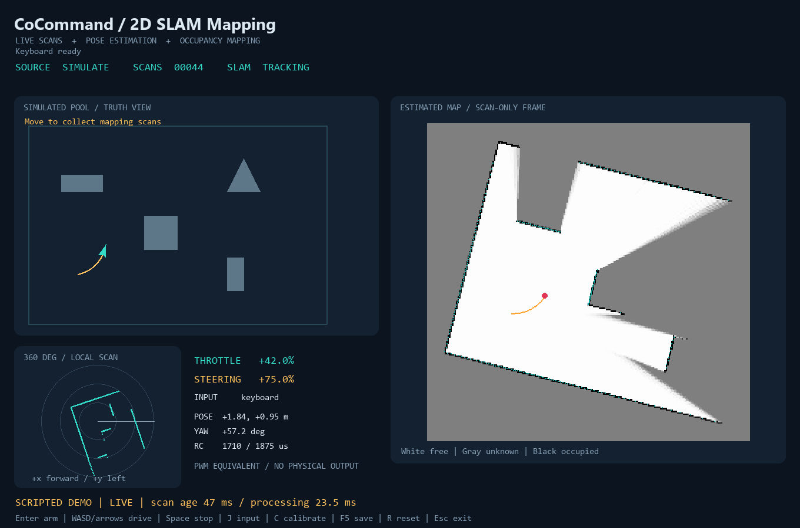

# CoCommand-USV 二维雷达 SLAM 建图平台

这是主仓库下的独立 Python 实验平台：`labs/lidar2d/`。核心流程是实时扫描、位姿估计、占据地图更新与录制回放；手动驾驶用于移动采集数据。无需 ROS、GPU、原生研究控制器或真实硬件即可运行。现有研究算法和船舶动力学未改动。

收到 Windows 便携 ZIP 后，先完整解压，再双击根目录的 `01_START_SIMULATION.cmd`；完整步骤见 [运行指引和工作流程](../../START_HERE_CN.md)。便携包自带 Python 和依赖。下面的安装步骤用于 GitHub 普通源码下载。



界面左上是仿真水池与真实运动轨迹，右侧是**仅由扫描估计**的占据地图和轨迹，左下是当前 360° 扫描。界面使用英文短标签，避免不同 Windows 字体配置造成乱码；使用说明为中文。

## 1. 实际实现与边界

- 真实 C1：官方 SLAMTEC C++ SDK 的独立进程桥接，设备型号、健康、扫描模式检测，460800/8N1，HQ 扫描读取，角度/距离/质量转换，错误日志、超时和自动重连。
- 在线建图：扫描到局部子地图的 point-to-line ICP、鲁棒加权、几何退化检查、二维位姿、射线自由空间更新和 log-odds 占据地图。**不是固定位置叠加点云**。
- 手动仿真：比例油门和转向、简化运动学与响应滞后、船体碰撞约束、虚拟雷达、可见轨迹。无目标点或导航路线。
- 输入：Pygame 手柄自动发现、热插拔、摇杆/单扳机映射、范围和中位校准、死区、按键映射；键盘可独立驾驶。
- 保存：统一 JSONL 扫描、NPZ/PGM 地图、地图坐标说明、CSV 估计轨迹、摘要和截图；支持按原时间间隔播放或无界面重建。
- `RCSignal` 仅计算 PWM 脉宽等效数值，没有真实电调/舵机输出路径。

**硬件状态：C1 和实体游戏手柄尚未实测。** SDK 编译、数据转换、模拟进程断连/重连、模拟手柄比例控制通过，不等于硬件验收。详见 [测试证据](docs/VALIDATION_CN.md)。

## 2. 安装（推荐 Python 3.11）

以下命令从 **CoCommand-USV 仓库根目录**执行。Windows 需要已安装的 64 位 Python 3.11；只有连接真实 C1 时才需要 C++ 编译器和 CMake。

```powershell
py -3.11 -m venv .venv
.venv\Scripts\python.exe -m pip install -e "labs/lidar2d[test]"
.venv\Scripts\python.exe -m cocommand2d simulate
```

如果 `py` 不存在，使用已安装的 Python 3.11 的完整路径运行第一条命令。无需激活虚拟环境，也无需更改 PowerShell 执行策略。

Linux/macOS：

```sh
python3.11 -m venv .venv
.venv/bin/python -m pip install -e 'labs/lidar2d[test]'
.venv/bin/python -m cocommand2d simulate
```

基本依赖是 NumPy、SciPy、pygame-ce、pyserial；pytest 仅用于测试。Python 3.11 与 3.12 的 Windows 本地测试已执行；其它操作系统的验证状态以 CI 为准。

## 3. 键盘自由驾驶

```powershell
.venv\Scripts\python.exe -m cocommand2d simulate --output output/my-drive --record output/my-drive/scans.jsonl
```

| 操作 | 功能 |
|---|---|
| Enter | 控件处于中位时启用仿真控制 |
| W/S 或上/下 | 连续增加正/负油门，松开后逐渐回中 |
| A/D 或左/右 | 连续左/右转向，正值为左转 |
| Space | 立即将控制命令归零并解除启用；船因模型惯性逐渐减速 |
| J | 键盘/手柄切换；切换后需重新启用 |
| C | 开始或结束手柄校准 |
| F5 | 保存当前地图、轨迹与摘要 |
| R | 重置 SLAM，下一帧成为新局部原点；控制解除启用 |
| Esc / 关闭窗口 | 保存地图和截图后退出 |

失去窗口焦点、手柄断开或输入切换会解除启用。重新连接后不会自动恢复上一次油门。键盘是无实体手柄时的比例输入替代，油门变化经过连续斜坡。

普通 `simulate` 完全由操作者驾驶；只有显式 `--demo` 才使用确定性的测试控制输入。船头与雷达零度默认一致，雷达位于船模型参考点。

## 4. USB / 蓝牙手柄

先在 Windows 设置中连接设备，确保系统可以识别其轴和按钮。程序自动发现第一只手柄，在顶部显示设备名；按 J 选择手柄，所有控件回中后按 Enter，或使用配置的 arm 按钮。

```powershell
.venv\Scripts\python.exe -m cocommand2d simulate --controller-config labs/lidar2d/configs/gamepad.json
```

示例配置默认：轴 1 反向为油门，轴 0 反向为转向，按钮 0 为启用、按钮 1 为停止。不同手柄轴序号和方向可能不同，需要实际检查。支持一只活动手柄，未实现多手柄选择菜单。

按 C 开始校准，完整移动所选摇杆/扳机到两端，然后**松手回中，再按 C**。保存到 `--controller-config` 指定文件，未指定时为 `output/controller.json`。校准过程不允许驾驶；行程不足会提示失败。配置文件的 `index`、`invert`、`deadzone` 和 `buttons` 可手动修改后重启。

- `mode: "signed"`：中位为 0，上/下或前/后分别映射到 [-1, 1]，支持正反油门。
- `mode: "trigger"`：从端点到端点映射到 [0, 1]，适合单扳机前进油门；根据设备休止端设置 `invert`。不自动合并两个扳机。
- 例如原始范围 [-1, 1]、死区 0.1 时，摇杆 0.55 对应 50% 指令；不是开/关控制。
- `rc.minimum_us / neutral_us / maximum_us` 配置模拟脉宽，例如 1000/1500/2000 µs；数值仅供显示，电脑不产生实际 PWM。

## 5. 可复现示例、测试与离线建图

```powershell
# 固定水池、seed=7，500 线虚拟扫描，10 Hz，30 秒测试输入
.venv\Scripts\python.exe -m cocommand2d simulate --headless --demo --steps 300 --seed 7 --record output/demo/scans.jsonl --output output/demo

# 同一段扫描重新建图，SLAM 不读取 truth_evaluation.csv
.venv\Scripts\python.exe -m cocommand2d replay --headless --file output/demo/scans.jsonl --output output/rebuilt

# 实时节奏播放（2 倍速），观察重新建图过程
.venv\Scripts\python.exe -m cocommand2d replay --file output/demo/scans.jsonl --speed 2 --output output/replay-view

# GUI 测试演示；关闭时自动截图，也可指定固定渲染帧数
.venv\Scripts\python.exe -m cocommand2d simulate --demo --frames 1200 --output output/gui-demo

.venv\Scripts\python.exe -m pytest labs/lidar2d/tests -q
```

示例场景是 18 × 12 m 水池、四个静态多边形参照物，供雷达扫描和建图使用。模拟雷达量程 12 m、距离噪声标准差 1 cm。`--demo` 使用固定油门 0.42、左转向 0.75 的开环控制，形成可复现弯曲运动。真实水池的材质、反射、遮挡和运动畸变不会被这个简单模型充分模拟。

默认输出目录为 `output/年月日-时分秒`。显式复用 `--output` 会更新该目录的地图和摘要；**录制文件使用独占新建，不覆盖已有记录**，重跑应换目录或文件名。

| 文件 | 含义 |
|---|---|
| `scans.jsonl`（需指定 `--record`） | 经统一接口规范化的传感器测量；不含真值，不是 UART 字节流转储 |
| `map.npz` | `log_odds`、`observed`、`origin`、`resolution` |
| `map.pgm` | 白色自由、灰色未知、黑色占据；图像上方为 +y |
| `map.json` | 米制分辨率、局部坐标原点、图像方向与轨迹列说明 |
| `trajectory.csv` | 时间、估计 x/y/yaw、匹配状态；yaw 单位为弧度 |
| `summary.json` | 帧数、软件处理耗时、匹配失败数、仿真评价误差 |
| `truth_evaluation.csv` | 仅仿真评价用的真值；不会进入 SLAM 或回放接口 |
| `screenshot.png` | GUI 正常退出时截取的实际画面 |
| `session.log` | 连接、SDK 设备/健康信息和错误日志 |

R 重置会开启新的地图坐标原点，保存的估计轨迹仅包含重置后的段；录制文件仍保留本次会话全部扫描。重放整个文件会按其第一帧建立地图。长记录允许流式读取，不一次性加载到内存。损坏行、未知坐标系、重复或倒退时间戳会带行号报错。

## 6. 真实 RPLIDAR C1 / C1M1

### 硬件依据

已阅读用户提供的 `SLAMTEC_rplidar_datasheet_C1_v1.2_en.pdf`（2026-03-12，rev.1.2），并核对参数表和坐标图：

| 参数 | 本实现采用值 / 官方说明 |
|---|---|
| 串口 | 460800 bit/s，8 数据位、1 停止位、无校验（第 14 页） |
| 扫描 | 8–12 Hz，典型 10 Hz；5 kHz 采样，典型每圈约 500 点（第 9 页） |
| 距离 | 白色目标 0.05–12 m；低反射黑色目标 0.05–6 m（第 9 页） |
| 坐标 | 正前方 +x，原始角度顺时针增大（第 11 页） |
| 电气 | 5 V 供电，通信为 3.3 V TTL UART；启动电流典型 800 mA（第 12–14 页） |
| 电机 | C1 电机工作状态随扫描命令；本实现使用 SDK 扫描启动/停止（第 14 页） |

使用合适的官方 USB 适配器和充足电源，不把 TTL UART 直接接到 RS-232 电平接口。此处涉及雷达采集，不涉及船舶推进器。

原始角度仅在驱动边界转换一次：

```text
theta_ccw_rad = wrap(mount_yaw_rad - theta_cw_deg * pi / 180)
distance_m = distance_mm / 1000
x = distance_m * cos(theta_ccw_rad)
y = distance_m * sin(theta_ccw_rad)
```

因此 C1 原始 90° 在标准坐标中为右侧 (0, -r)。模拟、SLAM、JSONL 都采用 **x 前、y 左、逆时针 yaw**。屏幕只在绘图时反转 y。`--mount-yaw` 表示雷达正前方相对实验前向的逆时针安装偏角（度），没有平移外参或船体遮挡标定。

零距离、非有限数、超出量程、零质量值被标记无效；无效数据不作为障碍，也不据此清空自由空间。保留 SDK 的 HQ quality 原值，**不把它宣称为经过校准的反射率**。点数和角度可变，不假设每圈恰好 500 点或等角度采样。

### 编译官方 SDK 桥接

真实设备数据经官方 SDK 解包；没有使用旧款 Python `rplidar` 驱动。已核对官方 SDK 支持列表包含 C1。为便于复现，当前验证提交固定为 `99478e5fb90de3b4a6db0080acacd373f8b36869`。

安装 Git、CMake 3.20+ 和 Visual Studio 2022 的 C++ 桌面开发工具后，在开发者 PowerShell 执行：

```powershell
git clone https://github.com/Slamtec/rplidar_sdk.git .external/rplidar_sdk
git -C .external/rplidar_sdk checkout 99478e5fb90de3b4a6db0080acacd373f8b36869
cmake -S labs/lidar2d/native -B build-c1 -A x64 "-DRPLIDAR_SDK_ROOT=$((Resolve-Path .external/rplidar_sdk).Path)"
cmake --build build-c1 --config Release --parallel 2
```

Linux/macOS 使用已安装的 C++17 编译器：

```sh
git clone https://github.com/Slamtec/rplidar_sdk.git .external/rplidar_sdk
git -C .external/rplidar_sdk checkout 99478e5fb90de3b4a6db0080acacd373f8b36869
cmake -S labs/lidar2d/native -B build-c1 -DCMAKE_BUILD_TYPE=Release -DRPLIDAR_SDK_ROOT="$PWD/.external/rplidar_sdk"
cmake --build build-c1 --parallel 2
```

CMake 配置期间不下载网络依赖。SDK 源码留在忽略目录；新桥接只调用 SDK API，未复制 GPL 示例程序。SDK 许可文件复制到构建目录，分发桥接二进制时须一并保留；仓库自身的许可状态仍遵循主项目说明。

### 检测、连接、录制

```powershell
.venv\Scripts\python.exe -m cocommand2d ports
.venv\Scripts\python.exe -m cocommand2d lidar --bridge build-c1/Release/cocommand_c1.exe --port COM5 --baud 460800 --record output/c1-session/scans.jsonl --output output/c1-session
```

Ninja/单配置构建的 Windows 路径为 `build-c1/cocommand_c1.exe`；Linux/macOS 为 `build-c1/cocommand_c1`，串口示例 `/dev/ttyUSB0` 或 `/dev/cu.usbserial-*`。

`ports` 只列举串口，不假定 USB 转串口适配器就是 C1。必须显式指定端口，连接后通过 SDK 确认型号为 C1M1、读取固件和健康状态、查询扫描模式并启动典型模式。**10 Hz 是设备典型值，不是软件保证的实测频率。** 代码不硬编码旧协议启动字节，也不擅自复位异常设备。

断流/进程退出时显示错误并按 1、2、4、8 秒上限重试。GUI 不等待串口读操作；正常退出请求桥接停止扫描并断开，失去响应才结束子进程。设备断开期间地图停留在最后一次结果，但数据年龄持续增加并标记过期。重连后若雷达已经大幅移动，局部匹配可能无法恢复，应按 R 在新原点重新建图。

## 7. 实时建图与录制工作流程

在线运行链路是：

```text
C1 SDK 后台采集 ─┬─> 规范化扫描记录（可选）
                └─> 有界最新数据队列 ─> 当前局部扫描 ─> 扫描匹配 ─> 在线地图/轨迹/GUI
虚拟雷达 / 离线记录 ────────────────> 同一 Scan 接口 ───────────┘
```

**当前局部扫描**展示这一圈测距结果，**累计地图**融合已成功匹配的多帧扫描，**估计轨迹**展示雷达相对首帧的运动。实时采集、建图与录制可以同时进行，无需先录完再建图。

`Observation` 提供当前扫描、估计位姿、匹配状态、主机收包时间和处理耗时：

- `fresh()` 默认超过 350 ms 则为 False；`localized()` 还要求匹配成功。
- 回放始终标记为离线，不能伪装成当前传感器数据。
- UI 显示 `scan age` 与 `processing`。真实数据年龄从 Python 接收完整桥接包时计算，包含之后的排队和处理；**不包含硬件采样至桥接输出之前的延迟**。一圈内部约 100 ms 的采样时差、USB/SDK 缓冲必须在硬件联调时测量。
- 显示端积压时优先消费最新帧；录制在显示队列之前进行。队列是有界的，极端负载下仍可能丢帧并计数，不能宣称无损或硬实时。
- 目前 SLAM 与绘图在 GUI 线程处理；串口采集在后台。软件测试测量了处理耗时，但真实雷达到地图显示的完整延迟仍需实机测量。

## 8. 算法与独立模块

```text
src/cocommand2d/
  scan.py           统一只读观测：时间、角度、距离、质量、有效标志
  lidar/            官方 SDK 子进程、诊断、重连、有界队列
  slam/             ICP 位姿估计、子地图、占据栅格
  simulation/       水池、简化船模型、碰撞、射线雷达
  controller/       摇杆校准、比例输入、控制保护、模拟 RC、舵角扩展接口
  recording/        JSONL 录制/回放、地图与轨迹输出
  visualization/    Pygame 实时仪表界面
  app.py            运行编排；仿真真值仅在这里用于离线误差评价
native/             C1 官方 SDK 桥接与独立 CMake
tests/              自动化验收和异常测试
```

SLAM 用第一帧建立局部原点；将新扫描与最多 16 个关键帧构成的局部子地图匹配，解算 x/y/yaw。每帧做距离门限、鲁棒残差权重、法向几何信息退化检测和运动幅度检查。匹配通过才沿激光射线更新自由/占据栅格。地图固定 40 × 40 m、分辨率 0.08 m，越界显示警告；类构造器可调整。

SLAM 模块只接收 `Scan`，不导入仿真、船模或控制模块；没有真值位置参数，也没有 IMU/GPS/里程计、卡尔曼滤波、水动力学依赖。测试从独立生成的扫描估计平移/转向，并检查模块依赖边界和录制回放一致性。

BreezySLAM 官方 README 将 Python 支持列为 Linux/macOS，Windows 列在 C++ 支持中；本次未把其 Python 扩展作为 Windows 3.11 依赖，也未宣称完成 BreezySLAM/C1 硬件适配。采用 NumPy/SciPy 的轻量实现便于独立安装和检查，代价是没有完整成熟 SLAM 系统的全局能力。

## 9. 已知限制与故障处理

| 现象 | 检查与处理 |
|---|---|
| 启动后船不动 | 所有输入回中后 Enter；确认当前是键盘还是手柄；窗口需保持焦点 |
| 前后/左右反向，或扳机休止就有油门 | 修改对应轴 `index/invert/mode`，重新 C 校准；未回中不会启用 |
| 没有串口 | 检查 USB 数据线、适配器驱动、电源、设备管理器；Linux 检查串口权限 |
| 串口占用/无法读取设备信息 | 关闭 RoboStudio 等占用程序；确认实际端口及 460800；日志显示 SDK 错误码 |
| 质量低、距离跳变、扫描停止 | 检查供电、光学窗口、目标反射、遮挡和设备健康码；不要用异常回波清空地图 |
| LOST / DEGENERATE | 减速，保持多方向静态结构；回到上一位置，必要时 R 重置 |
| 地图扭曲或轨迹漂移 | 纯雷达局部匹配没有全局重定位和回环优化；高速旋转、动态物体和稀疏几何会出错 |
| STALE / WAITING FOR SCAN | 当前扫描已过期；屏幕保留最后一次地图，检查数据源和连接 |
| Map boundary | 默认地图范围有限；调整 `LidarSlam(extent=..., resolution=...)` 后重新运行 |
| JSONL 行号错误 | 文件被截断、手工修改或时间倒退；保留原件，检查对应行；不会静默跳过错误 |

其它限制：无扫描运动去畸变、无全局回环/重定位、无动态目标跟踪；地图假设环境主要静态；没有水面反射/透明材质模型、船体俯仰补偿或雷达安装外参标定。长直走廊、圆形对称空间、开阔水域、重复结构会弱化可观测性；退化检测只是诊断，不能保证发现全部错误匹配。当前场景及毫米级软件误差属于理想化合成数据结果，不能外推到真实水池。

## 10. 后续硬件联调顺序

1. C1 固定桌面运行，核对型号/健康/端口，测量实际每圈点数、频率、数据年龄和连续录制完整性。
2. 在前、右、后、左放置目标，验证 C1 顺时针转换和安装偏角；人工测距检查米/毫米转换。
3. 缓慢平移/旋转雷达，检查在线轨迹；断开/重新连接 USB，确认错误、过期标记、重连及退出停止扫描。
4. 实体手柄检查轴范围、死区、两端百分比和各按钮，拔线/断蓝牙必须归零并重新启用。
5. 水池中只做感知与记录，对照独立位置参考评估漂移、延迟、反射和遮挡；不连接真实推进输出。

## 官方参考

- [SLAMTEC C1 文档、手册、协议下载入口](https://www.slamtec.com/en/support)
- [官方 RPLIDAR SDK（包含 C1 支持说明）](https://github.com/Slamtec/rplidar_sdk)
- [当前验证的 SDK 源码版本](https://github.com/Slamtec/rplidar_sdk/tree/99478e5fb90de3b4a6db0080acacd373f8b36869)
- [BreezySLAM 平台支持与安装说明](https://github.com/simondlevy/BreezySLAM)
